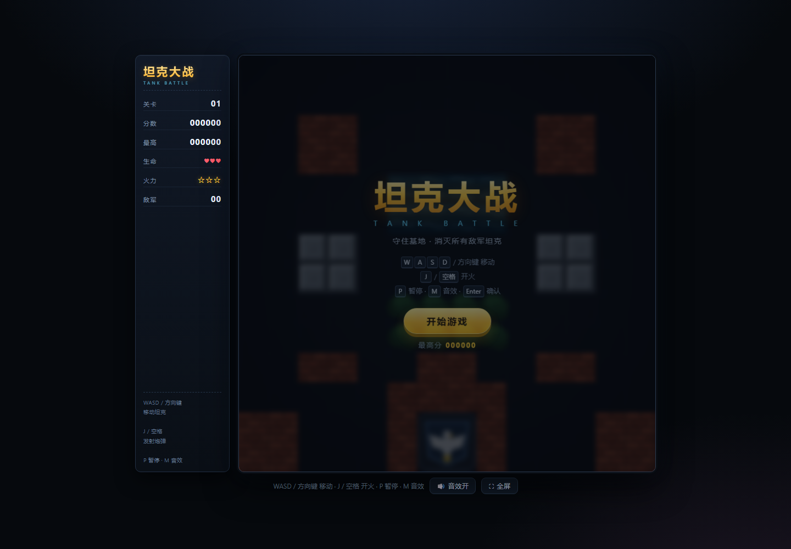
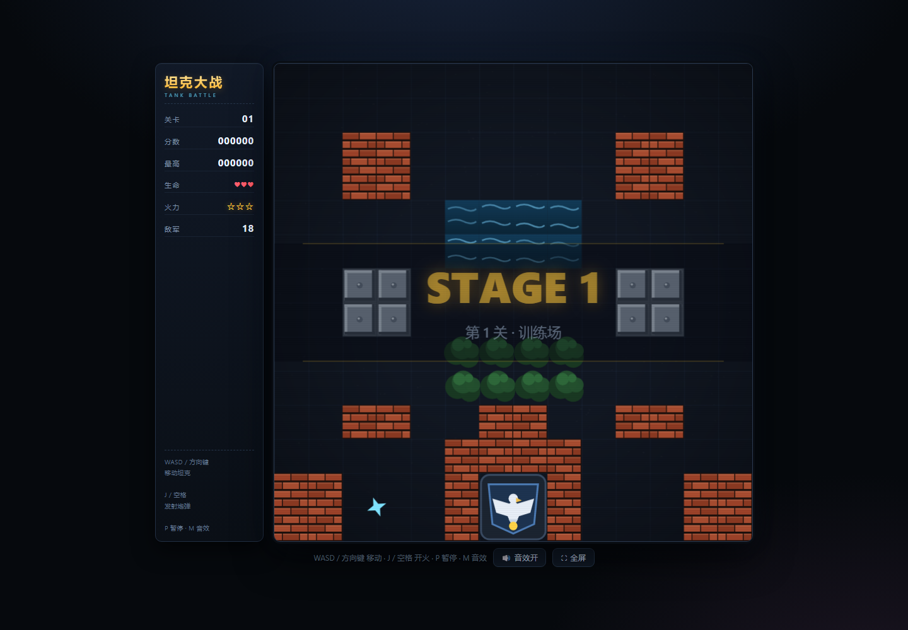

# 坦克大战 · TANK BATTLE

一个单文件、零依赖的 HTML5 Canvas 坦克大战小游戏。守住基地，消灭所有敌军坦克！





## 在线试玩

仓库根目录的 `index.html` 即完整游戏，**双击即可在浏览器中打开**，无需安装任何东西。

如果开启了 GitHub Pages（仓库 Settings → Pages → Source 选择 `main` 分支根目录），也可以直接在线玩。

## 特性

- 🎮 **纯前端单文件**：HTML + CSS + 原生 JavaScript，无框架、无构建、无外部资源，离线可玩
- 🗺️ **3 个手工关卡**：训练场、钢铁要塞、死亡迷宫，通关后可循环挑战
- 🤖 **4 种敌军坦克**：普通、快速、火力、重甲，带寻路 AI，会追击玩家和基地
- 🧱 **可破坏地形**：砖墙一发打出坦克宽的通道，钢墙需要满级火力才能击穿，另有水面、树林（可隐蔽）
- ⭐ **6 种道具**：火力升级、护盾、手雷、加命、铁铲（基地加固）、时钟（冻结敌人）
- 🎯 **完整玩法**：基地防守、生命值、计分、最高分本地记录、关卡结算、暂停/重开
- 🔊 **程序化音效**：Web Audio 实时合成，无音频文件，可一键静音
- 📱 **触屏支持**：手机/平板自动显示虚拟方向键与开火键，画面自适应窗口

## 操作

| 按键 | 功能 |
| --- | --- |
| `W` `A` `S` `D` / 方向键 | 移动坦克 |
| `J` / `空格` | 开火（可长按连发） |
| `P` / `Esc` | 暂停 / 继续 |
| `M` | 音效开关 |
| `Enter` | 确认（开始、继续、下一关、重开） |

触屏设备使用屏幕下方的方向键和「开火」按钮。

## 道具说明

| 图标 | 道具 | 效果 |
| --- | --- | --- |
| ★ | 火力升级 | 提升炮弹速度；2 级可同时发射两发；3 级可击穿钢墙 |
| 盾 | 护盾 | 9 秒内免疫伤害 |
| 炸 | 手雷 | 立即消灭场上所有敌军坦克 |
| 命 | 加命 | 生命 +1 |
| 铲 | 铁铲 | 基地围墙变成钢墙，持续 15 秒 |
| 钟 | 时钟 | 冻结全部敌军 8 秒 |

## 敌军与分数

| 类型 | 颜色 | 特点 | 击毁得分 |
| --- | --- | --- | --- |
| 普通坦克 | 灰蓝 | 速度慢、火力弱 | 100 |
| 快速坦克 | 青色 | 移动速度很快 | 200 |
| 火力坦克 | 紫色 | 炮弹速度极快 | 300 |
| 重甲坦克 | 红/橙/黄/灰 | 需要多次命中，颜色随血量变化 | 400 |

闪烁的敌军坦克被击毁后必定掉落道具。关卡通关还有额外奖励分。

## 目录结构

```
.
├── index.html              # 游戏本体（单文件，含全部 CSS/JS）
├── assets/                 # README 截图
├── scripts/
│   ├── check.mjs           # 语法与地图数据校验
│   └── smoke.mjs           # 无浏览器运行时冒烟测试（DOM/Canvas 桩）
├── README.md
└── LICENSE
```

## 本地开发 / 校验

```bash
# 语法与地图数据校验（需要 Node.js 20+）
node scripts/check.mjs

# 运行时冒烟测试：用 DOM 桩驱动约 60 秒随机操作，捕获运行时异常
node scripts/smoke.mjs
```

## 技术说明

- 渲染：`<canvas>` 2D，按设备像素比自适应缩放；地图瓦片、坦克、炮弹、基地、粒子特效全部程序化绘制
- 循环：`requestAnimationFrame` + 固定时间步（1/60s），高刷新率屏幕上逻辑速度一致
- 地图：14×14 网格，`#` 砖墙、`@` 钢墙、`~` 水面、`T` 树林，通关后销毁状态重置
- 碰撞：坦克 AABB 与瓦片/基地/其他坦克碰撞；炮弹按 5px 子步进检测，避免穿透
- 音效：Web Audio API 振荡器 + 噪声合成，首次交互后解锁
- 存档：最高分与静音设置保存在 `localStorage`

## License

[MIT](LICENSE)
